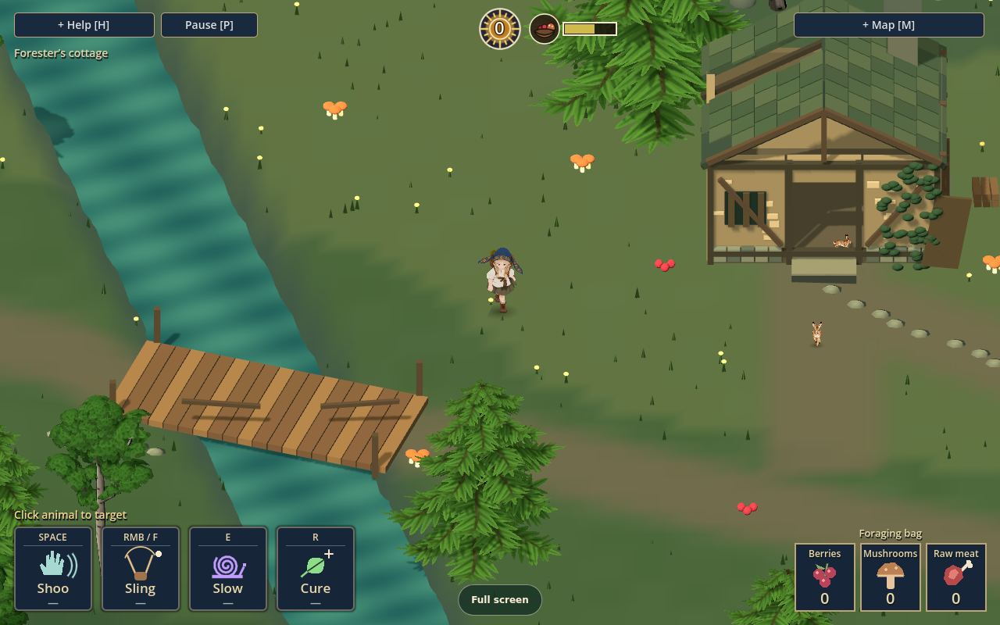
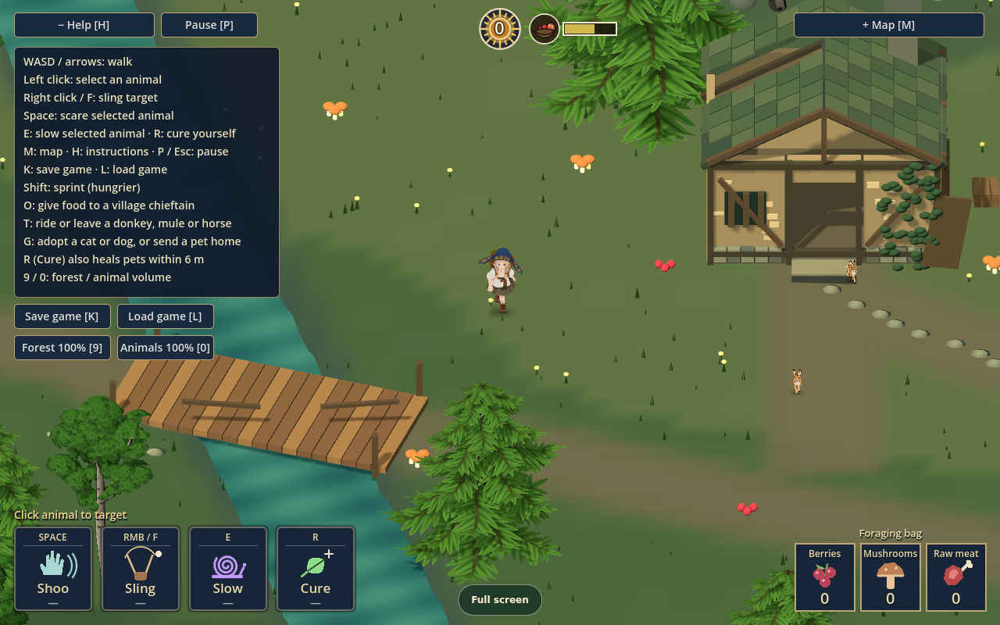
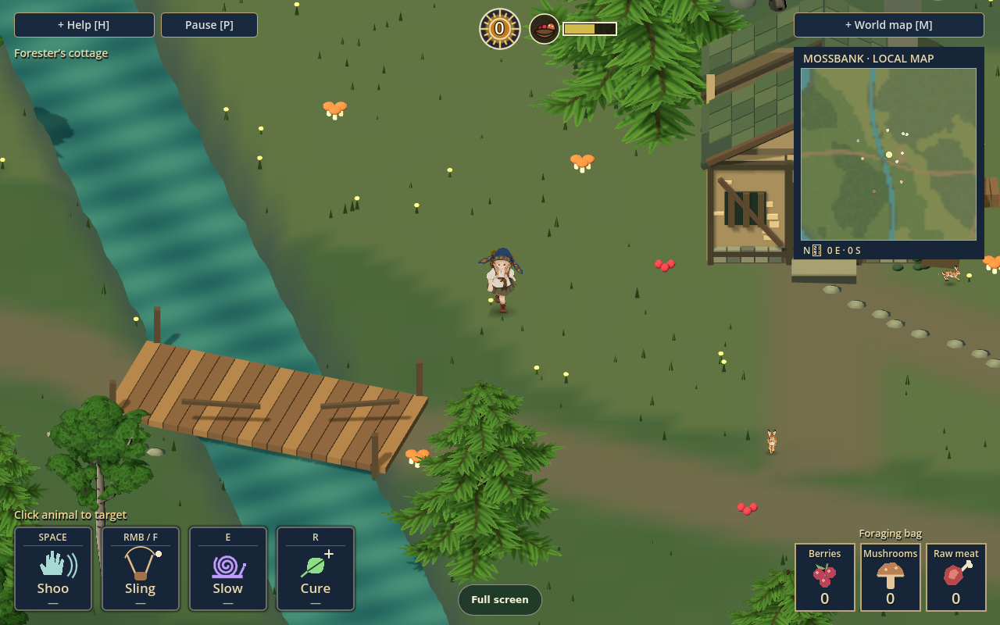
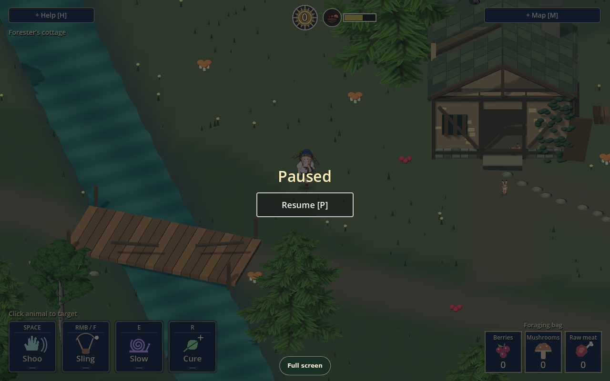

## Enter Mossbank woods

Choose **Enter the forest** on the browser start screen. You begin beside the forester's cottage. The game is an exploration and foraging prototype: follow paths, cross waterways using bridges, gather food and see what is living nearby.

Use **WASD or the arrow keys** to walk. Water, trunks, large rocks and walls block the way. Your view follows you; paths and bridges help you find a way through. **Shift** sprints, at a higher hunger cost.

## Gather and watch

Walk over accessible food to collect it with keyboard/touch controls; on a controller, use **A / Cross** nearby. The foraging bag shows berries, mushrooms and raw meat. Food and wildlife are part of the world, so approach them and watch their behavior rather than expecting every location to be a fixed pickup.

Left-click an animal to select it. Empty ground clears the selection. The selected target and its range affect whether a skill can be used.

## Four skills, one selected target

| Skill | Default key | What it does |
| --- | --- | --- |
| Shoo | Space | Scares the selected animal away temporarily |
| Sling | Right mouse button or F | Throws a stone at the selected target and can stun it |
| Slow | E | Slows the selected animal |
| Cure | R | Ends Oravitsa’s stun or panic and heals nearby pets |

The visible skill bar and Help show the current controls. The sling's ordinary wildlife interaction is non-lethal. Hares are the exception: the game's rules allow collecting a stunned hare for raw meat. Do not assume every stunned creature can be collected.

## Keep Help close

Press **H** to open the in-game instructions and press it again to hide them. They include the current skill keys, interaction keys, Save/Load buttons and sound levels.

On a standard controller, use the left stick to walk and the right stick to select a target. The published source documents **LT / L2** for Shoo, **RT / R2** for Sling, **LB / L1** for Slow, **RB / R1** for Cure, and **A / Cross** to pick up.

## Map and orientation

Press **M** to cycle through the local map, the larger explored-world map, and hidden. The local map appears beside the forest view. The larger map records discovered landmarks such as hamlets and caves, so it can be sparse early in a run. Use both alongside the world itself as you explore.

## Pause, save and load

Press **P** or **Escape** to pause; use **Resume** or **P** to return. Saving is separate: **K** saves the game and **L** loads it, and the same buttons are available in Help.

There is **one manual save slot and no autosave**. Saves belong to this browser/device. Use the game's explicit Save action before leaving; a new browser or clearing site data does not bring the old slot along.

## About this guide

This field guide describes the public browser demo and its displayed controls. The published source receipt names clean source `58c23f61b96fff082abed2e919e5cdf6f3c74ed0`; the screenshots were captured from that public game. The project's broader design and development can continue beyond this guide's version.
